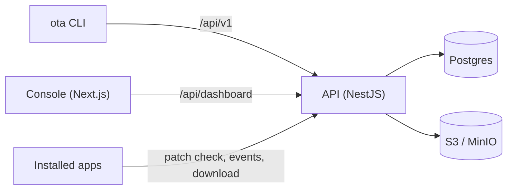

# How it works

Three things talk to one server: the developer's machine through the `ota` CLI, a browser through the console, and every installed app through its updater. Nothing on the phone contacts anyone but your server.

## Concepts

- **App:** one ID, in `ota.yaml`, shared by Android and iOS.
- **Release:** a version of the app that shipped through a store, such as `1.0+1`. Patches belong to exactly one release, so an app never runs code built for another version.
- **Patch:** new code for a release, numbered from 1.
- **Channel:** who gets a patch. `stable` by default.

## The update check

The app sends `POST /api/v1/patches/check` with its app ID, release version, platform, architecture and channel. The server answers with the newest patch still live on that channel, plus the numbers of any patches rolled back.

Devices are anonymous. The server only sees a random client ID the app generated.

## React Native

The SDK keeps one small state file and moves each patch through three slots:

1. **next:** downloaded, hash checked and unpacked. Runs on the next launch.
2. **booting:** set just before the patch loads for the first time.
3. **current:** set when the running JavaScript confirms it works, two seconds after launch.

If the app starts and finds a patch still in `booting`, the last launch crashed. The patch is marked failed, deleted and never runs again. The app boots the last good patch or the bundle inside the app, and reports the failure to the server.

A store update changes the release version, so the SDK clears all patches on the first launch after it.

A patch is a `.tar.gz` of the Hermes bundle and its assets. Packing is deterministic, so `ota patch` can tell when nothing changed.

Native code lives in [`react-native/android`](../react-native/android) and [`react-native/ios`](../react-native/ios). The two platforms implement the same state machine.

## Flutter

The engine loads a patched `libapp.so` in place of the one in the app. The Rust updater inside the engine does the check, the download and the crash rollback. Patches are binary diffs against the release, so they are usually a few kilobytes.

A few names are compiled into the engine, such as the file it reads its config from. The Flutter tool writes that file from your `ota.yaml`, so you never see it. These names are listed in [`toolchain_names.dart`](../cli/packages/ota_cli/lib/src/toolchain_names.dart) and can only change with a new engine build.

## Release version format

Both frameworks use `name+build`: `versionName+versionCode` on Android and `CFBundleShortVersionString+CFBundleVersion` on iOS.
